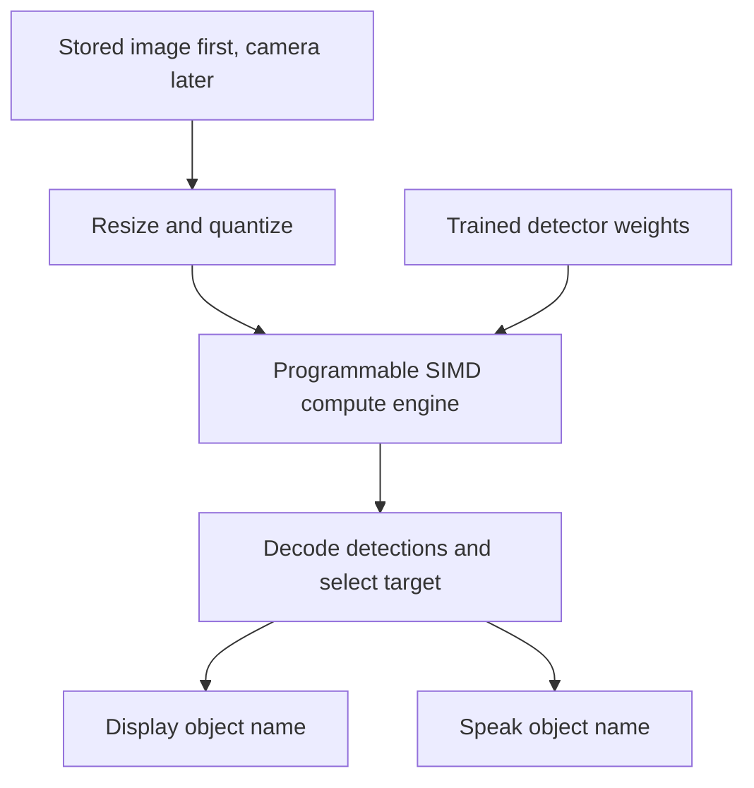

# Project04

## Everyday object recognition for smart glasses

Custom CPU and GPU hardware in SystemVerilog for looking at an everyday object, identifying it, and displaying or speaking its name.

The first development target is a verified inference datapath operating on stored images. Live camera input, spoken or displayed names, and glasses integration follow that foundation.

## Initial scope

- Recognize a broad set of everyday objects supported by the selected trained detector; recognition is not restricted to chairs.
- Develop and verify arithmetic units, memory movement, neural-network kernels, and a programmable SIMD compute engine.
- Use ChipVerify Lab for SystemVerilog simulation and waveform inspection.
- Begin with stored images and a software numerical reference before adding live camera input.
- Defer CPU firmware, FPGA selection, and wearable integration.

## Current status

The first arithmetic RTL is implemented: scalar INT8 DOT4 with INT32 accumulation, an eight-lane SIMD arithmetic slice, and a configurable INT8 requantizer. Self-checking SystemVerilog tests and a Python numerical reference are included.

Seven Python reference tests pass, and the four canonical SystemVerilog files pass static compilation with zero diagnostics. **Full behavioral RTL verification is pending confirmed PASS output.** A user-reported traced run hit ChipVerify's 100 MB waveform limit; the testbench now separates the full untraced regression from a short waveform smoke test. No trained model or end-to-end object-recognition result is claimed. See [verification status](docs/verification_status.md).

## Repository structure

| Directory | Purpose |
| --- | --- |
| `rtl/` | Synthesizable SystemVerilog modules |
| `tb/` | Self-checking testbenches and compact test vectors |
| `models/` | Model selection, numerical contract, class map, and artifact metadata |
| `docs/` | Architecture decisions, verification plan, and simulator workflow |
| `scripts/` | Integer reference, optional static compiler check, and bundle generation |
| `tests/` | Python numerical reference tests |
| `sim/` | Source file list and generated ChipVerify inputs |

## Proposed data flow



The trained detector provides recognition through its learned weights. The custom hardware executes its calculations. The eventual CPU controls jobs and application behavior; the GPU subset executes parallel kernels. Model selection determines the required operators, tensor memory, and compute capacity.

This diagram describes planned behavior. No end-to-end inference system, display driver, audio driver, or trained model is implemented yet.

## First milestones

See [the work packages and acceptance gates](docs/build_plan.md). The first implementation is [specified here](docs/arithmetic_spec.md); its behavioral regression must pass before arithmetic is treated as verified.

1. Select and profile a compact pretrained detector covering many everyday object categories.
2. Freeze tensor shapes, weights, quantization rules, supported operations, and class labels.
3. Implement a packed signed INT8 dot-product unit with INT32 accumulation and verify it against a software reference.
4. Implement and verify requantization, then one real convolution layer.
5. Integrate the supported model and validate full detections on stored images.

The eventual system includes a custom CPU and programmable parallel compute engine. CPU integration, live capture, audio, and display output follow numerical correctness of the inference datapath.

## Simulation

The next integration milestone is implemented: [memory-backed DOT4 engine](docs/memory_engine.md). It adds scratchpad memory, a read/compute/write controller, and a separate self-checking suite. Use the pair of files in `sim/chipverify_memory/` with top `tb_p04_dot4_engine`. Its static checks pass; its behavioral simulation is ready to run in ChipVerify.

See [the ChipVerify workflow](docs/chipverify.md). Use `sim/chipverify/design.sv` and `sim/chipverify/testbench.sv` with top `tb_p04_arithmetic`. Source files and testbenches are versioned here; run logs and waveform dumps are generated outputs.

```sh
python3 -m unittest discover -s tests -v
python3 scripts/bundle_chipverify.py --check
```

## Model artifacts

Do not commit third-party model weights until the model, redistribution permissions, provenance, and artifact size have been reviewed. Record exact hashes and acquisition instructions alongside the numerical reference.

## License

No project license has been selected. Third-party artifacts retain their own licenses and terms.
