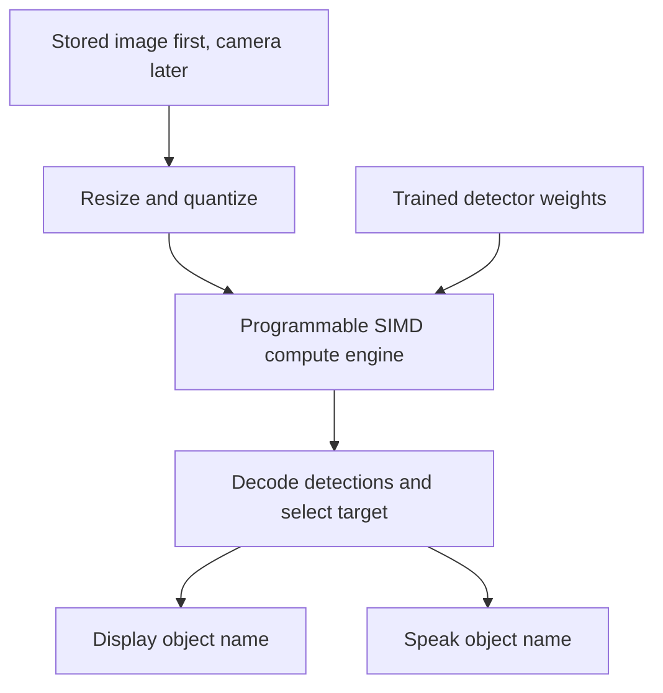

# Project04

## Everyday object recognition for smart glasses

Custom CPU and GPU hardware in SystemVerilog for looking at an everyday object, identifying it, and displaying or speaking its name.

The default Mac test path now combines pretrained software object detection with RTL feedback memory and image attributes. A separate small custom-trained classifier runs full inference in RTL. Camera, preview and speech use the Mac; FPGA and chip interfaces come later.

## Initial scope

- Recognize a broad set of everyday objects supported by the selected trained detector; recognition is not restricted to chairs.
- Develop and verify arithmetic units, memory movement, neural-network kernels, and a programmable SIMD compute engine.
- Use local Icarus Verilog for the Mac-to-RTL camera path; existing block tests can still run in ChipVerify.
- Begin with stored images and a software numerical reference before adding live camera input.
- Defer CPU firmware, FPGA selection, and wearable integration.

## Basic object recognition plus feedback learning

The default camera feedback path now includes the pretrained COCO detector from the original working demo. It can name supported objects such as **phone, laptop, chair, bottle, cup and keyboard without first teaching those categories**. Confirmations and corrections build persistent examples for later views; there is no 20-view collection requirement.

```bash
git pull
source .venv-camera/bin/activate
python -m pip install -r app/requirements-hybrid-camera.txt
python app/mac_rtl_camera.py learn --speak --voice
```

Read [setup and learning behavior](docs/feedback_learning.md). **Execution is HYBRID:** pretrained neural detection runs in Python/PyTorch; descriptor extraction, remembered-example distance/similarity, and crop attributes run in SystemVerilog simulation. The full pretrained detector is not implemented in RTL. The app identifies the prediction source.

The detector receives the full captured frame, selects an object, and passes that object's crop to RTL. Compatible confirmed views can override its name when the appearance match is sufficiently close. Corrections persist across restarts; weak or incompatible memory matches leave the pretrained name in place. Existing memories are preserved, with crop/context compatibility checks. Exact product variants and manufacturer specifications are not inferred.

Y confirms, N rejects, C types a correction, V listens, and Space captures the next stable view. Use `--recognizer rtl-only` to retain the prior memory-only behavior without a software detector. Native voice still needs Apple command-line tools and permission. Icarus must be installed locally.

## Previous custom-trained MLP path

**Mac camera -> RTL recognition -> overlay/speech is implemented for a small custom-trained classifier.** Read [the setup and training guide](docs/rtl_camera.md). This version requires at least 20 camera captures for each of 2–16 labels and one offline training run. It is not a pretrained general object detector.

- `app/mac_rtl_camera.py`: five-second stability/focus gate, camera preview, capture collection, offline training, simulator transport, and macOS speech.
- `rtl/p04_camera_mlp.sv`: full 768 -> 32 ReLU -> N-class fixed-point inference, approximate softmax/rejection, mean RGB, crop brightness, and coarse crop color.
- `tb/tb_p04_camera_mlp.sv`: file-to-pixel and model loader, reset cancellation checks, and result transport.
- Verification: 16 test methods passed; 28 actual Icarus image simulations match an independent integer reference. Offline CLI training/export/inference also passed on synthetic color samples. Live Mac GUI/camera/speech and real-object model accuracy require user testing.

The previous `app/mac_camera.py` remains a separate pretrained **software-only** detector. Its model does not run in our RTL. Product model/manufacturer, OCR, multiple-object boxes, and arbitrary everyday recognition are not provided by the new tiny classifier. See [verification status](docs/verification_status.md).

## Repository structure

| Directory | Purpose |
| --- | --- |
| `rtl/` | Synthesizable SystemVerilog modules |
| `tb/` | Self-checking testbenches and compact test vectors |
| `models/` | Model selection, numerical contract, class map, and artifact metadata |
| `docs/` | Architecture decisions, verification plan, and simulator workflow |
| `scripts/` | Integer reference, optional static compiler check, and bundle generation |
| `tests/` | Python numerical reference tests |
| `sim/` | Source file list and generated ChipVerify inputs |

## Proposed data flow



The trained detector provides recognition through its learned weights. The custom hardware executes its calculations. The eventual CPU controls jobs and application behavior; the GPU subset executes parallel kernels. Model selection determines the required operators, tensor memory, and compute capacity.

This diagram describes planned behavior. No end-to-end inference system, display driver, audio driver, or trained model is implemented yet.

## First milestones

See [the work packages and acceptance gates](docs/build_plan.md). The first implementation is [specified here](docs/arithmetic_spec.md); its behavioral regression must pass before arithmetic is treated as verified.

1. Select and profile a compact pretrained detector covering many everyday object categories.
2. Freeze tensor shapes, weights, quantization rules, supported operations, and class labels.
3. Implement a packed signed INT8 dot-product unit with INT32 accumulation and verify it against a software reference.
4. Implement and verify requantization, then one real convolution layer.
5. Integrate the supported model and validate full detections on stored images.

The eventual system includes a custom CPU and programmable parallel compute engine. CPU integration, live capture, audio, and display output follow numerical correctness of the inference datapath.

## Run the Mac camera application

A local Mac application now opens a webcam, draws detected object boxes and names, and optionally speaks labels. See [installation and launch instructions](docs/mac_camera.md). It uses a pretrained **software** detector; the custom RTL is not yet a complete recognition accelerator.

```sh
python3 -m venv .venv-camera
source .venv-camera/bin/activate
python -m pip install -r app/requirements-mac.txt
python app/mac_camera.py
```

The same app path passed a saved-image detection test. Live Mac webcam, GUI and speech require local validation. An independent camera-stream RTL capture block and ChipVerify test bundle are in `sim/chipverify_camera/`.

## Real image and neural network milestone

A real pretrained software detector identified a dog in a public photograph with score about 0.75. New RTL provides RGB pixel centering and a multiword convolution-patch accumulator. Eight first-layer patches use actual image data and learned model weights. See [the scope, evidence and instructions](docs/image_nn.md).

Use `sim/chipverify_image/design.sv` and `sim/chipverify_image/testbench.sv` with top `tb_p04_image_nn`. The user reported a passing first-layer ChipVerify suite: 8 real-image patches, 13 jobs, 256 pixel triplets and 132 host checks. The full detector currently runs in software, not custom RTL.

## Simulation

The next integration milestone is implemented: [memory-backed DOT4 engine](docs/memory_engine.md). It adds scratchpad memory, a read/compute/write controller, and a separate self-checking suite. Use the pair of files in `sim/chipverify_memory/` with top `tb_p04_dot4_engine`. Its static checks pass; its behavioral simulation is ready to run in ChipVerify.

See [the ChipVerify workflow](docs/chipverify.md). Use `sim/chipverify/design.sv` and `sim/chipverify/testbench.sv` with top `tb_p04_arithmetic`. Source files and testbenches are versioned here; run logs and waveform dumps are generated outputs.

```sh
python3 -m unittest discover -s tests -v
python3 scripts/bundle_chipverify.py --check
```

## Model artifacts

Do not commit third-party model weights until the model, redistribution permissions, provenance, and artifact size have been reviewed. Record exact hashes and acquisition instructions alongside the numerical reference.

## License

No project license has been selected. Third-party artifacts retain their own licenses and terms.
